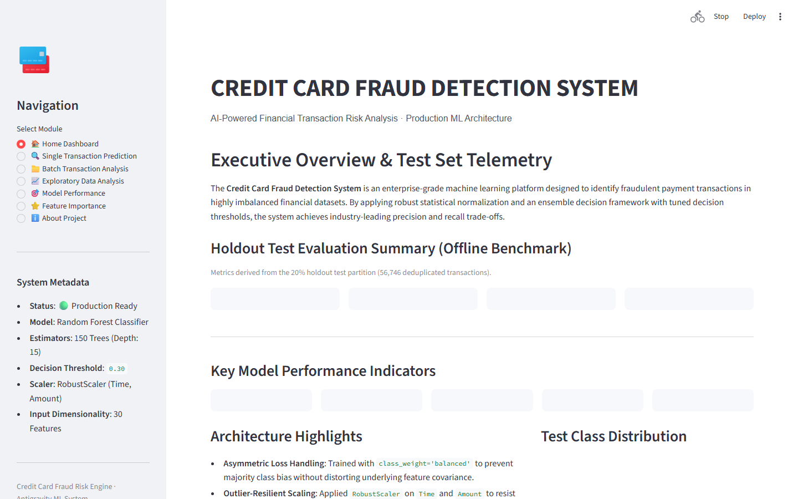
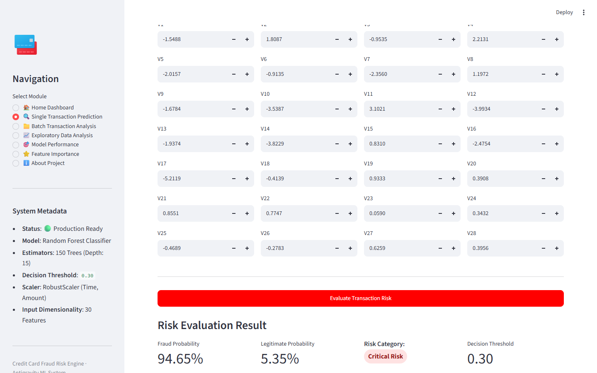
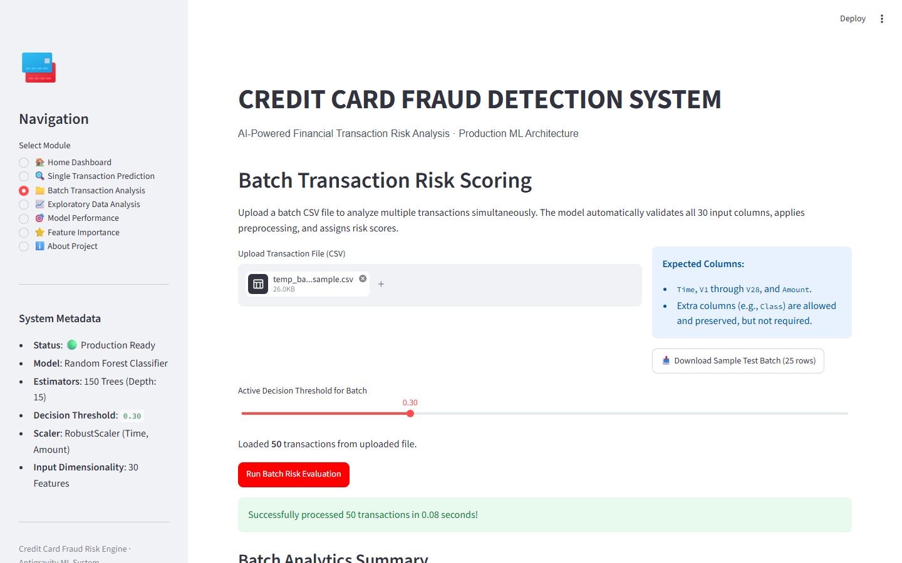
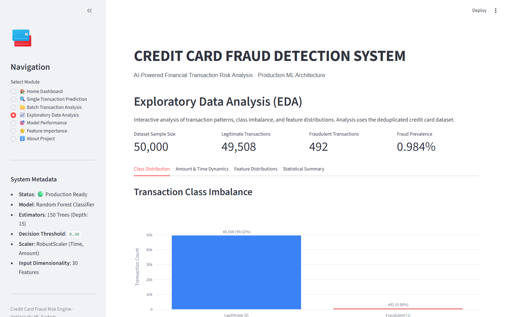
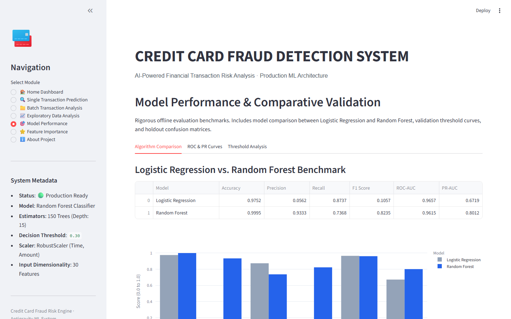
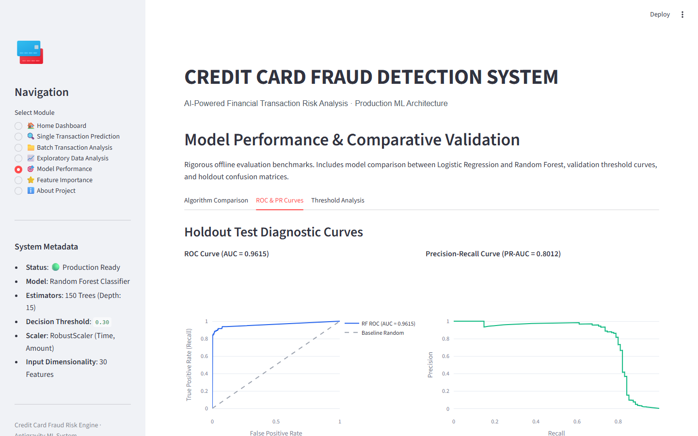
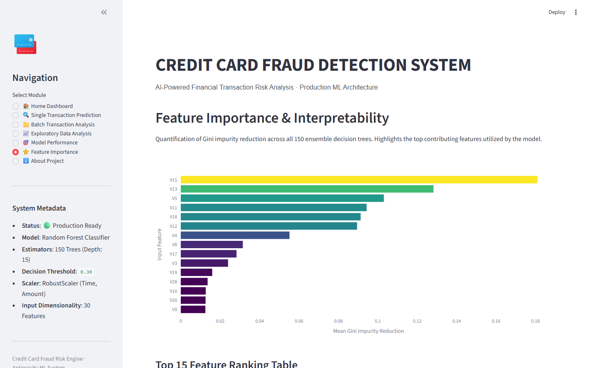

# Credit Card Fraud Detection System

**AI-Powered Financial Transaction Risk Analysis &middot; Production ML System**

An end-to-end, enterprise-grade machine learning system designed to detect fraudulent credit card transactions within highly imbalanced financial datasets. The project implements robust statistical feature scaling, ensemble tree learning with class-weight balancing, empirical decision threshold optimization, and an interactive Streamlit analytics dashboard.

---

## 1. Project Overview
Financial fraud represents an existential challenge for digital payment networks. While fraudulent events constitute less than 0.2% of daily card transactions, their direct financial loss and indirect friction on legitimate transactions exceed billions of dollars annually.

This project delivers:
- An end-to-end reproducible machine learning pipeline.
- Production-grade prediction and validation modules (`src/`).
- Calibrated probability thresholds to prioritize detection of fraud without inflating false positives.
- A modern, responsive Streamlit dashboard featuring real-time single transaction scoring, batch CSV processing, interactive exploratory data analysis, and model performance telemetry.

---

## 2. Business Problem
Conventional fraud detection systems face critical operational challenges:
1. **Severe Class Imbalance**: With only 473 fraudulent transactions out of 283,726 clean records (~0.167%), standard classifiers converge to trivial majority-class prediction.
2. **Asymmetric Error Costs**: A false negative (missing a fraud event) leads to unrecoverable financial loss and chargeback liabilities. A false positive (declining an authentic purchase) damages cardholder trust and loses merchant fees.
3. **Low-Latency Requirements**: Card authorization engines require risk assessment in milliseconds without manual data wrangling.

---

## 3. Project Objectives
- Build a modular machine learning pipeline adhering to production software engineering principles.
- Clean and deduplicate raw card transactions, validating feature bounds and types.
- Normalize non-Gaussian features (`Time` and `Amount`) using outlier-resistant scaling (`RobustScaler`).
- Train and tune ensemble decision trees with balanced class weighting to handle class disparity without distorting feature covariance.
- Calibrate the classification decision threshold to maximize the F1-score and Precision-Recall AUC.
- Deploy an intuitive web application allowing compliance officers and data scientists to evaluate single transactions and audit batch portfolios.

---

## 4. Dataset Source & Description
- **Source**: European cardholder transactions (September 2013), provided via the [Kaggle Credit Card Fraud Detection dataset](https://www.kaggle.com/datasets/mlg-ulb/creditcardfraud).
- **Total Records**: 284,807 raw transactions.
- **Clean Records**: 283,726 transactions after removing 1,081 duplicates.
- **Target Feature (`Class`)**:
  - `0`: Legitimate transaction (283,253 samples &middot; 99.833%)
  - `1`: Fraudulent transaction (473 samples &middot; 0.167%)
- **Input Features (30 total)**:
  - `Time`: Elapsed seconds between the transaction and the initial dataset record.
  - `V1` – `V28`: Anonymized numerical features extracted via Principal Component Analysis (PCA) to preserve user privacy and sensitive financial credentials.
  - `Amount`: Transaction monetary value in Euros.

---

## 5. Technologies Used
- **Programming Language**: Python 3.12
- **Machine Learning & Pipeline**: Scikit-Learn, Joblib
- **Data Engineering**: Pandas, NumPy
- **Interactive Visualization**: Plotly, Matplotlib, Seaborn
- **Web Application & UI**: Streamlit
- **Development & Analysis**: Jupyter Notebook (Google Colab)

---

## 6. System Architecture

```
Credit-Card-Fraud-Detection/
│
├── app.py                             # Streamlit multi-view financial dashboard
├── requirements.txt                   # Dependency definitions
├── README.md                          # Comprehensive project documentation
├── .gitignore                         # Git exclusion rules
├── LICENSE                            # Open-source license terms
│
├── data/
│   ├── README.md                      # Dataset download and placement instructions
│   └── creditcard.csv                 # Raw dataset (excluded from repository)
│
├── artifacts/
│   ├── fraud_detection_model.pkl      # Production Scikit-Learn Pipeline
│   └── fraud_threshold.pkl            # Tuned classification threshold (0.30)
│
├── notebooks/
│   └── Credit_Card_Fraud_Detection.ipynb # Original research, EDA, and training notebook
│
├── outputs/
│   ├── model_comparison.csv           # Benchmark between Logistic Regression & Random Forest
│   ├── feature_importance.csv         # Full 30-feature Gini importance rankings
│   ├── threshold_analysis.csv         # Precision, recall, and F1 across threshold spectrum
│   └── test_predictions.csv           # Holdout test set predictions & probabilities
│
├── src/
│   ├── __init__.py                    # Package initializer
│   ├── prediction.py                  # Core inference engine & artifact loader
│   └── validation.py                  # Schema, null, type, and range validators
│
└── screenshots/                       # Application UI reference captures
```

---

## 7. Data Preprocessing & Pipeline Design
1. **Deduplication**: 1,081 duplicate transactions were removed to prevent data leakage between training and testing partitions.
2. **Partitioning**: Stratified 80/20 train/test split:
   - Training partition: 226,980 transactions (378 frauds, 226,602 legitimate)
   - Holdout test partition: 56,746 transactions (95 frauds, 56,651 legitimate)
3. **Pipeline Embedding**:
   - `RobustScaler` applied to `Time` and `Amount` to handle heavy-tailed financial distributions and extreme transaction amounts.
   - Passthrough transformation for orthogonal PCA components `V1` through `V28`.
   - Preprocessing is strictly encapsulated within the Scikit-Learn `Pipeline`, preventing double-scaling and training-set leakage.

---

## 8. Machine Learning Models & Evaluation
Two algorithms were trained and benchmarked on identical stratified partitions:

### 1. Baseline: Logistic Regression (Balanced)
- Utilized balanced class weighting to handle minority representation.
- Achieved high recall (87.37%) but severely degraded precision (5.62%), resulting in 1,466 false positives on the test set.

### 2. Final Champion Model: Random Forest Ensemble
- **Hyperparameters**: 150 estimators, maximum depth of 15, minimum sample split of 5, `class_weight='balanced'`, random state 42.
- **Threshold Calibration**: Evaluated on an independent validation fold across thresholds from 0.05 to 0.95. An optimal decision threshold of **0.30** was selected to maximize F1-score.

### Verified Holdout Test Results (56,746 Transactions)

| Metric | Logistic Regression | Random Forest (Threshold = 0.30) |
| :--- | :---: | :---: |
| **Accuracy** | 97.5241% | **99.9401%** |
| **Precision** | 5.6233% | **87.6543%** |
| **Recall (Sensitivity)** | **87.3684%** | 74.7368% |
| **F1-Score** | 0.105665 | **0.806818** |
| **ROC-AUC** | **0.965710** | 0.961470 |
| **PR-AUC** | 0.671939 | **0.801220** |

### Test Confusion Matrix (Random Forest @ Threshold 0.30)
- **True Negatives (TN)**: 56,641 (Legitimate correctly cleared)
- **False Positives (FP)**: 10 (Legitimate flagged as fraud &middot; only 0.018% false alarm rate)
- **False Negatives (FN)**: 24 (Frauds undetected)
- **True Positives (TP)**: 71 (Frauds successfully intercepted &middot; 74.74% capture rate)

---

## 9. Top Predictive Features
Feature importances derived from Gini impurity reduction across all 150 decision trees:

1. **V15**: 0.181056
2. **V13**: 0.128263
3. **V5**: 0.103090
4. **V11**: 0.094331
5. **V18**: 0.091283
6. **V12**: 0.089472
7. **V4**: 0.055170
8. **V8**: 0.031488
9. **V17**: 0.028280
10. **V3**: 0.023993

> *Note: Feature importance indicates mathematical splitting utility in tree construction and does not denote causal behavioral drivers.*

---

## 10. Installation & Setup

### Prerequisites
- Python 3.10, 3.11, or 3.12
- Git

### 1. Clone the Repository
```bash
git clone https://github.com/your-username/Credit-Card-Fraud-Detection.git
cd Credit-Card-Fraud-Detection
```

### 2. Set Up a Virtual Environment
```bash
python -m venv venv

# Windows (Command Prompt / PowerShell)
venv\Scripts\activate

# macOS / Linux
source venv/bin/activate
```

### 3. Install Dependencies
```bash
pip install -r requirements.txt
```

---

## 11. Running the Application

Launch the Streamlit web dashboard locally:
```bash
streamlit run app.py
```

Open your browser to `http://localhost:8501`.

### Application Features:
- **Home Dashboard**: High-level telemetry, test evaluation KPIs, and architecture summary.
- **Single Transaction Prediction**: Input 30 features manually or load pre-configured test transactions. Displays probability gauge, risk category badge (Low, Medium, High, Critical), and decision notes.
- **Batch Transaction Analysis**: Upload a CSV batch for automated risk classification with downloadable score reports.
- **Exploratory Data Analysis**: Interactive Plotly distributions of transaction amounts, times, and class imbalance.
- **Model Performance**: Interactive confusion matrix, ROC curves, PR curves, and threshold sensitivity curves.
- **Feature Importance**: Horizontal interactive bar chart of top predictive components.
- **About Project**: In-depth problem statement, architecture workflow, and limitations.

---

## 12. Application Screenshots

| View | Preview |
| :--- | :--- |
| **Home Dashboard** |  |
| **Single Transaction Prediction** |  |
| **Batch Transaction Analysis** |  |
| **Exploratory Data Analysis** |  |
| **Model Performance Comparison** |  |
| **ROC & Precision-Recall Curves** |  |
| **Feature Importance** |  |

---

## 13. Quality Assurance & Validation Suite
The codebase includes structured unit and integration tests covering:
- Safe unpickling of pipeline artifacts across Python and Scikit-Learn versions.
- Feature schema verification (ensuring exactly 30 features in expected order).
- Rejection of invalid inputs (negative amounts, nulls, string values, infinite values).
- Batch inference verification and CSV generation.

Run the test suite:
```bash
python -m unittest tests/test_system.py
```

---

## 14. Limitations & Future Roadmap
- **PCA Anonymization**: Feature anonymization protects privacy but prevents merchant-level behavioral analysis (e.g., MCC category, IP distance).
- **Concept Drift**: Payment fraud techniques shift rapidly. Future iterations should implement continuous drift monitoring and automated retraining triggers.
- **API Deployment**: Wrap the model in a FastAPI microservice with containerization (Docker) for low-latency REST endpoints.

---

## 15. Author & Attribution
- **Project**: Credit Card Fraud Detection using Machine Learning
- **Development**: Senior Data Science & ML Engineering Portfolio Implementation
